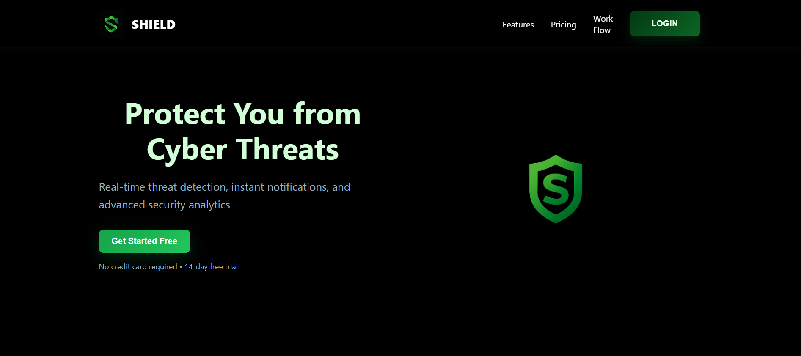
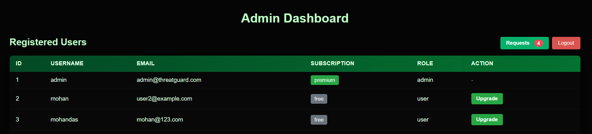
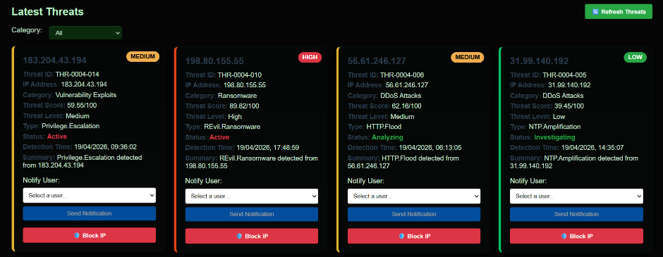
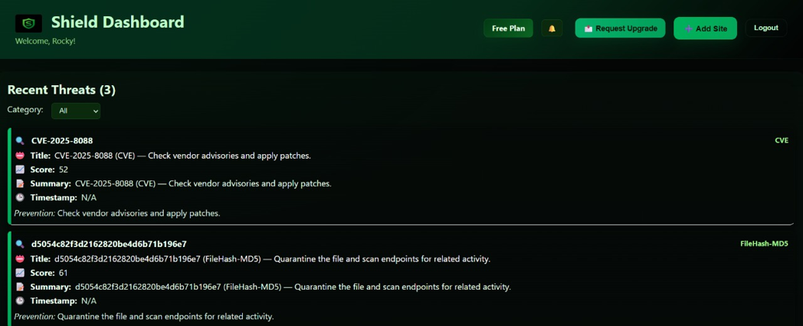
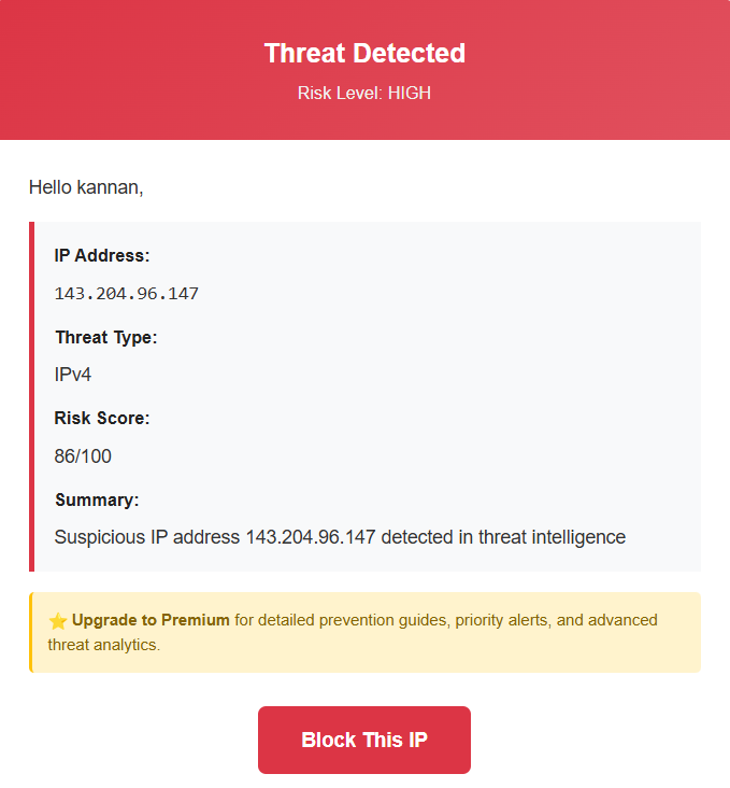
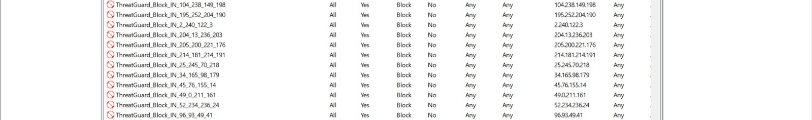

#  ThreatGuard – Cyber Threat Intelligence Auto-Defense System

ThreatGuard is a real-time Cyber Threat Intelligence (CTI) platform designed to monitor, analyze, and respond to cyber threats using AI-driven insights, intelligent risk scoring, and automated IP blocking.

The system integrates threat intelligence from AlienVault OTX and provides centralized monitoring, email alerts, and security audit logs to improve threat detection and response.

## 🚀 Features

- **Real-Time Threat Monitoring** – Collects threat intelligence from AlienVault OTX.
- **AI-Powered Analysis** – Generates threat summaries and supports threat assessment.
- **Intelligent Risk Scoring** – Assigns risk scores from 0 to 100 to prioritize threats.
- **Automated IP Blocking** – Blocks high-risk IP addresses with a configured threshold of 75.
- **Multi-Environment Defense** – Supports Windows Host Firewall and Kali Linux VM firewall integration.
- **Centralized Dashboard** – Provides threat monitoring and role-based administration.
- **Email Alerts** – Notifies users about high-risk threats.
- **Audit Logging** – Records security events and blocking activities.
- **Secure Authentication** – Uses JWT-based authentication.


## 📸 Project Screenshots

### Main Dashboard



### Admin Dashboard



### Threat Detection and Risk Scoring User Dashboard



### Email Notification Sample



### Blocked IP Addresses



## 🛠️ Technologies Used

- **Frontend:** React
- **Backend:** Python, Flask
- **Database:** SQLite
- **Authentication:** JWT
- **Threat Intelligence:** AlienVault OTX API
- **AI Integration:** Google Gemini API
- **Firewall Management:** Windows `netsh`, Linux `iptables`
- **API Communication:** REST API

## 🏗️ System Architecture

1. **Threat Collection:** Fetches threat intelligence data from AlienVault OTX.
2. **Threat Analysis:** Evaluates suspicious indicators and calculates risk scores.
3. **AI Summarization:** Generates concise summaries to help administrators understand threats.
4. **Alert Generation:** Displays high-risk threats on the dashboard and sends email notifications.
5. **Automated Defense:** Blocks eligible IP addresses on configured firewall environments.
6. **Audit Logging:** Records threat analysis and defense activities for later review.

## 🔄 Threat Detection Workflow

```text
AlienVault OTX
      ↓
Threat Intelligence Collection
      ↓
Risk Scoring and AI Analysis
      ↓
High-Risk Threat Identification
      ↓
Dashboard and Email Alerts
      ↓
Automated IP Blocking
      ↓
Audit Logs and Monitoring
```

## 🎯 Project Objectives

- Improve cybersecurity threat visibility.
- Reduce manual threat monitoring and firewall management.
- Prioritize suspicious IP addresses using risk scores.
- Enable faster responses through automated defense.
- Coordinate threat response across host and virtual machine environments.

## 🔐 Security Considerations

- Keep API keys and credentials in environment variables.
- Never commit `.env` files or secret tokens to GitHub.
- Run firewall blocking operations only in authorized test environments.
- Validate threat intelligence before applying firewall rules.
- Use appropriate permissions and safeguards when enabling automatic blocking.

## ▶️ Getting Started

1. Clone this repository.
2. Install the required backend dependencies.
3. Configure the necessary API keys and environment variables.
4. Start the backend server.
5. Install frontend dependencies and start the React application.
6. Configure the firewall agent and permissions before testing automated blocking.

Refer to the project configuration and dependency files for the exact setup commands.

## 🧪 Testing Environment

The project is designed to demonstrate threat monitoring and defensive actions across a Windows host and a Kali Linux virtual machine.

Test firewall rules and IP-blocking operations only on systems you own or are authorized to administer.

## 🔮 Future Enhancements

- Integration with additional threat intelligence sources.
- Advanced threat analytics and visualization.
- Improved threat correlation and risk prioritization.
- Enhanced monitoring across multiple endpoints.
- Expanded reporting and incident investigation capabilities.

## 👨‍💻 Project Information

**Project Name:** ThreatGuard – Real-Time Cyber Threat Intelligence Auto-Defense System

**Project Type:** Academic / Cybersecurity Project

**Focus Areas:** Cybersecurity, Threat Intelligence, AI-Assisted Analysis, Network Defense, and Automation

---

⭐ If you find this project interesting, feel free to explore the repository and its implementation.
